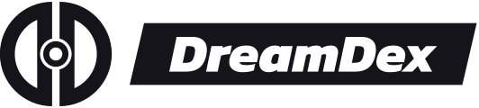
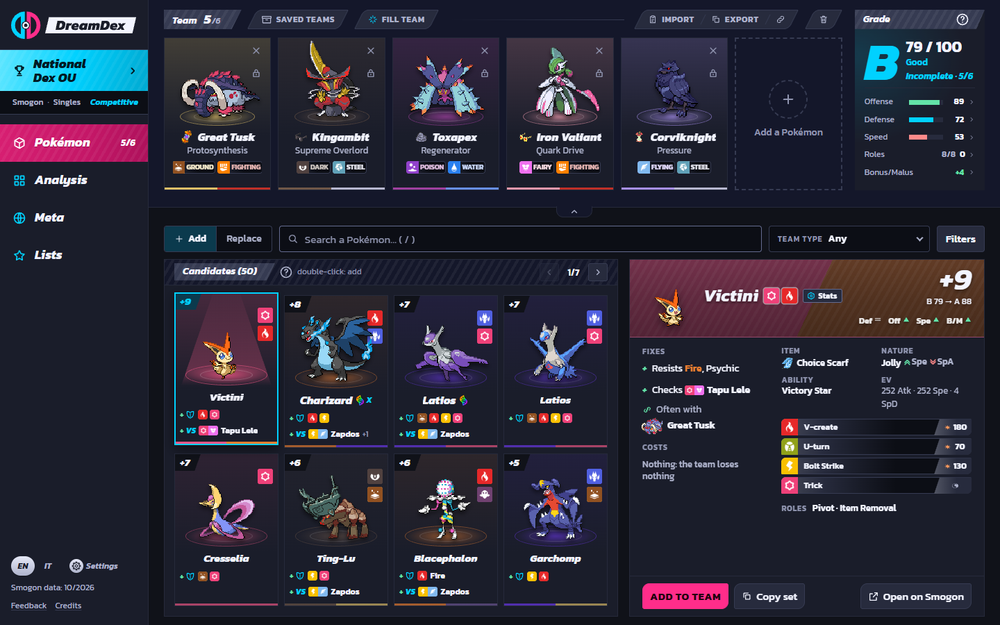
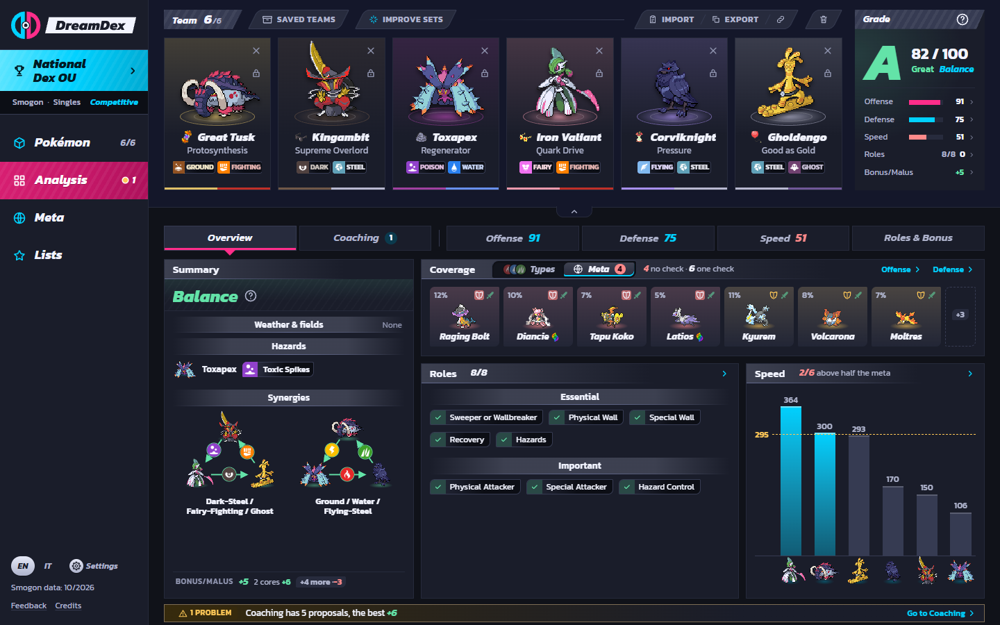
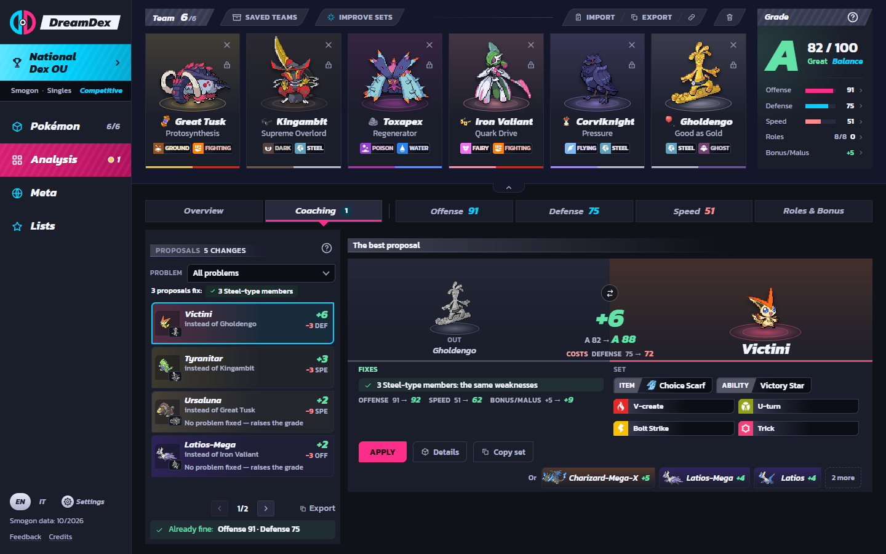

<picture>
    <source media="(prefers-color-scheme: dark)" srcset="docs/img/logo-dark.svg">
    
</picture>

DreamDex è un team builder per il Pokémon competitivo, in singolo e in doppio. Inserisci uno o più Pokémon e ti mostra in ordine quelli che completano meglio il team, gli dà un voto da S a D e spiega ogni numero, partendo dalle statistiche d'uso mensili di Smogon. L'interfaccia è in italiano o in inglese.

Si usa su **[dreamdex.pages.dev](https://dreamdex.pages.dev)**, direttamente nel browser e senza account.

[Read in English](README.md)



## Cosa fa

- Mette in ordine i candidati per il team e dice perché: quali debolezze coprono, quali minacce del meta gestiscono e cosa perde il team a prenderli.
- Dà al team un voto su 100, da S a D, diviso fra Offesa, Difesa, Velocità e Ruoli, con bonus e malus da aprire uno per uno.
- Il Coaching propone cambi di Pokémon e di set che alzano il voto, e mostra il voto nuovo prima di applicarli.
- Completa team costruisce team interi attorno ai Pokémon che hai già, per tipo di team (da Hyper Offense a Stall) o per condizione (pioggia, sole, sabbia, neve, Trick Room), e può caricare team veri da torneo.
- L'editor del set ha i preset di Smogon, EV, natura, Tera e mosse, più una prova dei matchup contro il meta.
- Import ed export per Showdown, team salvati e un link corto che contiene tutto il team.

| Analisi | Coaching |
| --- | --- |
|  |  |

## Formati

- Smogon: Gen 9 OU, Ubers, UU e Anything Goes; National Dex OU, Ubers, UU e Doubles.
- Giochi: Pokémon Scarlatto e Violetto.
- No Format: tutto permesso, con un limite di generazione se vuoi.
- In arrivo: VGC, Pokémon Champions e le generazioni Smogon precedenti.

I ban di ogni formato vengono da Pokémon Showdown e compaiono come problemi di regole sul team. Il meta entra nel voto quando Smogon ha pubblicato le statistiche del mese per quel formato.

## Come è fatto

React 19, TypeScript e Vite, con test in Vitest e Testing Library. La logica del team sta in `src/engine/`, senza codice dell'interfaccia; l'interfaccia è in `src/ui/` e i testi in italiano e inglese in `src/i18n/`.

A ogni push su `master` partono i test, si costruisce il sito e si pubblica su Cloudflare Pages. Ogni lunedì il sito si ricostruisce coi dati appena scaricati. Se un test fallisce o un download non riesce non si pubblica niente e resta online la versione di prima.

Per avviarlo sul tuo computer serve Node.js 22:

```sh
npm install
npm run fetch-data   # dati di Smogon, Showdown e PokeAPI in data/, può volerci qualche minuto
npm run dev
npm test
```

## Crediti

Dati da [Smogon](https://www.smogon.com/stats/) (statistiche d'uso e set), [Pokémon Showdown](https://pokemonshowdown.com) (formati, ban e sprite), [PokeAPI](https://pokeapi.co) (nomi italiani), [data.pkmn.cc](https://data.pkmn.cc) (set di Smogon e team da torneo) e [Serebii](https://www.serebii.net) (Pokémon esclusivi di versione). Librerie di [@pkmn](https://github.com/pkmn/ps) e [@smogon/calc](https://github.com/smogon/damage-calc). I disegni di Eevee sono di [dreamworld.svg](https://x.com/dreamworldsvg).

DreamDex è un progetto non ufficiale fatto da un fan, gratuito e senza scopo di lucro. Non è affiliato né approvato da Nintendo, Creatures, GAME FREAK, The Pokémon Company, Smogon o Pokémon Showdown. Pokémon e i nomi dei personaggi sono marchi di Nintendo, Creatures Inc. e GAME FREAK inc. I loghi dei formati e dei giochi appartengono ai rispettivi proprietari.

## Feedback

Un voto che non ti torna, un errore o un'idea? Usa "Segnala o suggerisci" in fondo alla barra a sinistra oppure [apri una issue](https://github.com/DGSimone99/DreamDex/issues).

## Licenza

Il codice è distribuito con [licenza MIT](LICENSE). Nomi, sprite e immagini dei Pokémon non rientrano nella licenza e appartengono ai rispettivi proprietari.
