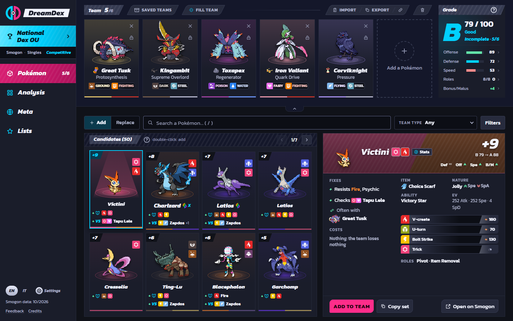
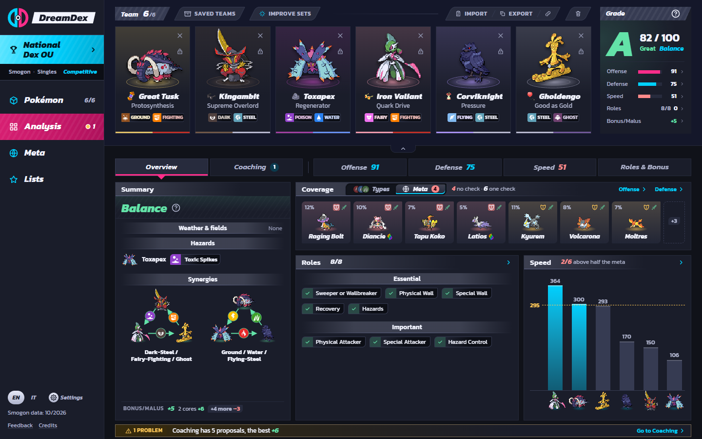
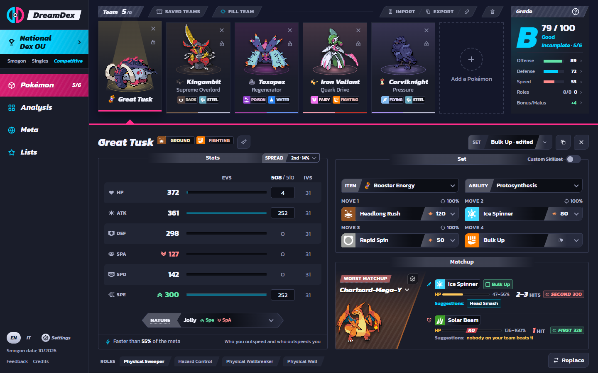
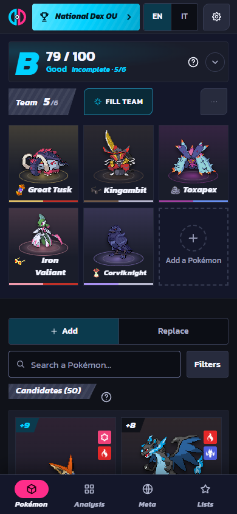

<div align="left">
    <picture>
        <source media="(prefers-color-scheme: dark)" srcset="docs/img/logo-dark.svg">
        
    </picture>

<h1>DreamDex</h1>


</div>

DreamDex is a team builder for competitive Pokémon, singles and doubles. Add one or more Pokémon and it ranks the ones that complete your team best, rates the team from S to D and explains every number, using the monthly Smogon usage statistics. The interface is in English or Italian.

Try it at **[dreamdex.pages.dev](https://dreamdex.pages.dev)**. It runs in the browser and needs no account.

[Leggi in italiano](README.it.md)



## What it does

- Ranks the candidates for your team and gives the reasons behind each one: the weaknesses it fixes, the meta threats it checks and what the team loses by taking it.
- Grades the team out of 100, from S to D, across Offense, Defense, Speed and Roles, with bonuses and penalties you can open one by one.
- Coaching proposes swaps and set changes that raise the grade and shows the new grade before you apply them.
- Fill team builds complete teams around the Pokémon you already have, by team type (from Hyper Offense to Stall) or condition (rain, sun, sand, snow, Trick Room), and can load real tournament teams.
- The set editor has Smogon presets, EVs, natures, Tera and moves, plus a matchup tester against the meta.
- Showdown import and export, saved teams and a short link that holds the whole team.

| Analysis | Coaching |
| --- | --- |
|  |  |

| Set editor | Phone |
| --- | --- |
|  |  |

## Formats

- Smogon: Gen 9 OU, Ubers, UU and Anything Goes; National Dex OU, Ubers, UU and Doubles.
- Games: Pokémon Scarlet and Violet.
- No Format: anything goes, with an optional generation limit.

The bans for each format come from Pokémon Showdown and appear as rule problems on the team. The meta counts in the grade whenever Smogon has published that month's statistics for the format.

## Requirements

- Node.js 22 (the version CI uses)
- npm

## Installation

```sh
git clone https://github.com/DGSimone99/DreamDex.git
cd DreamDex
npm install
npm run fetch-data
```

`npm run fetch-data` downloads the Smogon usage statistics and sets, the Showdown formats and bans, and the Italian names from PokeAPI into `data/`. That folder is not in the repository and the app is built from it, so run the command before the first start. It can take several minutes when the Smogon servers are slow. Run it again to get a newer month of data.

## Configuration

The feedback form sends messages through Web3Forms and reads its access key from `VITE_WEB3FORMS_KEY`, for example in `.env.local`. Without the key the form only shows the link to GitHub issues. Nothing else needs configuring.

## Quick start

```sh
npm run dev
```

Vite prints the local address, usually `http://localhost:5173`. Pick a format in the sidebar and add a Pokémon to get the first suggestions.

## Testing

```sh
npm test
```

`npm run build` checks the types and writes the production build to `dist/`.

## How it is built

React 19, TypeScript and Vite, tested with Vitest and Testing Library. The team logic lives in `src/engine/` with no UI code in it; the interface is in `src/ui/` and the English and Italian texts in `src/i18n/`. `DESIGN.md` describes the visual system and `PRODUCT.md` the product.

Every push to `master` runs the tests, builds the site and deploys it to Cloudflare Pages. Every Monday the site is rebuilt with freshly downloaded data. If a test fails or a download breaks, nothing is published and the previous version stays online.

Developed with AI assistance (Claude Code).

## Credits

Data from [Smogon](https://www.smogon.com/stats/) (usage statistics and sets), [Pokémon Showdown](https://pokemonshowdown.com) (formats, bans and sprites) and [PokeAPI](https://pokeapi.co) (Italian names). Libraries from [@pkmn](https://github.com/pkmn/ps) and [@smogon/calc](https://github.com/smogon/damage-calc). The Eevee drawings are by [dreamworld.svg](https://x.com/dreamworldsvg).

DreamDex is an unofficial fan project, free and non-commercial. It is not affiliated with or endorsed by Nintendo, Creatures, GAME FREAK, The Pokémon Company, Smogon or Pokémon Showdown. Pokémon and character names are trademarks of Nintendo, Creatures Inc. and GAME FREAK inc.

## Feedback

Found a grade that looks wrong, a bug, or have an idea? Use Feedback at the bottom of the sidebar or [open an issue](https://github.com/DGSimone99/DreamDex/issues).
