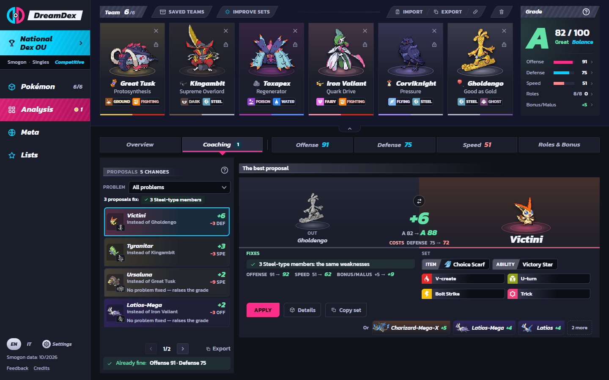

<picture>
    <source media="(prefers-color-scheme: dark)" srcset="docs/img/logo-dark.svg">
    
</picture>

DreamDex is a team builder for competitive Pokémon, singles and doubles. Add one or more Pokémon and it ranks the ones that complete your team best, rates the team from S to D and explains every number, using the monthly Smogon usage statistics. The interface is in English or Italian.

Try it at **[dreamdex.pages.dev](https://dreamdex.pages.dev)**. It runs in the browser and needs no account.

[Leggi in italiano](README.it.md)


## What it does

- Ranks the candidates for your team and gives the reasons behind each one: the weaknesses it fixes, the meta threats it checks and what the team loses by taking it.
- Grades the team out of 100, from S to D, across Offense, Defense, Speed and Roles, with bonuses and penalties you can open one by one.
- Coaching proposes swaps and set changes that raise the grade and shows the new grade before you apply them.
- Fill team builds complete teams around the Pokémon you already have, by team type (from Hyper Offense to Stall) or condition (rain, sun, sand, snow, Trick Room), and can load real tournament teams.
- The set editor has Smogon presets, EVs, natures, Tera and moves, plus a matchup tester against the meta.
- Showdown import and export, saved teams and a short link that holds the whole team.

| Analysis                                                                                                         | Coaching                                                                                                                 |
| ---------------------------------------------------------------------------------------------------------------- | ------------------------------------------------------------------------------------------------------------------------ |
|  |  |

## Formats

- Smogon: Gen 9 OU, Ubers, UU and Anything Goes; National Dex OU, Ubers, UU and Doubles.
- Games: Pokémon Scarlet and Violet.
- No Format: anything goes, with an optional generation limit.
- More to come: VGC, Pokémon Champions and the older Smogon generations.

The bans for each format come from Pokémon Showdown and appear as rule problems on the team. The meta counts in the grade whenever Smogon has published that month's statistics for the format.

## How it is built

React 19, TypeScript and Vite, tested with Vitest and Testing Library. The team logic lives in `src/engine/` with no UI code in it; the interface is in `src/ui/` and the English and Italian texts in `src/i18n/`.

Every push to `master` runs the tests, builds the site and deploys it to Cloudflare Pages. Every Monday the site is rebuilt with freshly downloaded data. If a test fails or a download breaks, nothing is published and the previous version stays online.

To run it locally you need Node.js 22:

```sh
npm install
npm run fetch-data   # Smogon, Showdown and PokeAPI data into data/, can take a few minutes
npm run dev
npm test
```

## Credits

Data from [Smogon](https://www.smogon.com/stats/) (usage statistics and sets), [Pokémon Showdown](https://pokemonshowdown.com) (formats, bans and sprites), [PokeAPI](https://pokeapi.co) (Italian names), [data.pkmn.cc](https://data.pkmn.cc) (Smogon sets and tournament teams) and [Serebii](https://www.serebii.net) (version-exclusive Pokémon). Libraries from [@pkmn](https://github.com/pkmn/ps) and [@smogon/calc](https://github.com/smogon/damage-calc). The Eevee drawings are by [dreamworld.svg](https://x.com/dreamworldsvg).

DreamDex is an unofficial fan project, free and non-commercial. It is not affiliated with or endorsed by Nintendo, Creatures, GAME FREAK, The Pokémon Company, Smogon or Pokémon Showdown. Pokémon and character names are trademarks of Nintendo, Creatures Inc. and GAME FREAK inc. Format and game logos belong to their owners.

## Feedback

Found a grade that looks wrong, a bug, or have an idea? Use Feedback at the bottom of the sidebar or [open an issue](https://github.com/DGSimone99/DreamDex/issues).

## License

The code is released under the [MIT License](LICENSE). Pokémon names, sprites and artwork are not covered by it and belong to their owners.
